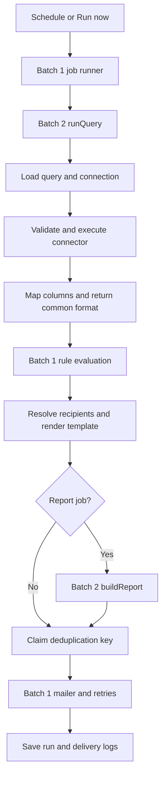

# Notification Engine Implementation

This document describes the current implementation of the Notification Engine. Batch 1 and Batch 2 have separate sections in this file, followed by their integration contract and shared setup instructions.

| Area | Batch 1 | Batch 2 |
|---|---|---|
| Main responsibility | Notification scheduling and delivery | Data connections, query execution, and reports |
| Backend modules | `server/engine/`, notification routes, and notification models | `server/connectors/`, `server/core/`, `server/reports/`, connection and query services |
| Frontend screens | Login, Job Dashboard, Job Setup, Recipient Lists, Templates, Run History | Connections and Query Setup |
| Primary output | Emails, job runs, and delivery logs | Common-format query results and generated report files |

The shared stack uses React with Vite, Node.js with Express, MongoDB with Mongoose, and JWT authentication. Both batches run inside the same application.

## 1. Batch 1: Notification Engine

### 1.1 Purpose

Batch 1 uses saved queries supplied by Batch 2 to run business notifications. An administrator selects a query, defines matching rules, chooses recipients and a template, and sets a schedule. The engine retrieves data, prepares messages or report attachments, prevents duplicate sends, and records the outcome.

### 1.2 Implemented modules

| Feature | Implementation files | Behavior |
|---|---|---|
| Authentication | `server/routes/auth.js`, `server/middleware/auth.js` | Checks login credentials with bcrypt, issues an eight-hour JWT, and verifies bearer tokens on protected requests. |
| Frontend session | `client/src/context/AuthContext.jsx`, `client/src/components/ProtectedRoute.jsx` | Stores the token and user in session storage, protects application routes, and clears the session on logout. |
| Job management | `server/routes/jobs.js`, `client/src/pages/Jobs.jsx`, `client/src/pages/JobSetup.jsx` | Creates, edits, deletes, enables, disables, manually runs, and previews jobs. |
| Scheduling | `server/engine/scheduler.js` | Converts schedule fields into cron expressions and registers enabled jobs with `node-cron`. |
| Rule evaluation | `server/engine/rules.js` | Converts tabular results into objects and keeps rows that satisfy every configured condition. |
| Recipient lists | `server/routes/recipientList.js`, `client/src/pages/Recipients.jsx` | Maintains named To, CC, and BCC lists. |
| Templates | `server/engine/template.js`, `server/controllers/templateController.js`, `client/src/pages/Templates.jsx` | Manages subjects and bodies, fills Handlebars placeholders, and supports previews. |
| Email delivery | `server/engine/mailer.js` | Sends through Nodemailer and applies the environment-controlled test-mode recipient override. |
| Run orchestration | `server/engine/runner.js` | Loads dependencies, retrieves data, applies rules, prepares emails, claims deduplication keys, retries delivery, and saves run results. |
| Run history | `server/controllers/runHistoryController.js`, `client/src/pages/RunHistory.jsx` | Displays run outcomes and delivery details. |

### 1.3 Job configuration and scheduling

A job stores its name, saved `queryId`, mode, rules, schedule, recipients, template reference, report formats, and enabled state. Jobs reference saved queries rather than storing connector-specific SQL.

The supported modes are:

- `message`: prepare one email for each matching record.
- `report`: prepare one email to a recipient list with the matching rows attached.

Schedules support every 1–59 minutes, daily, selected weekdays, and a selected day of the month. The default timezone is `Asia/Kolkata`. Saving, enabling, disabling, or deleting a job refreshes its scheduler registration. At server startup, enabled jobs are loaded from MongoDB and registered again.

Before an enabled job is saved, the API checks that it has a query, a valid schedule, recipients, and a template. Report jobs also need a recipient list and at least one report format. Scheduled tasks use `noOverlap: true` within the running server process.

### 1.4 Execution flow

1. A scheduled task or the **Run now** action calls `runJob(jobId)`.
2. The runner loads the job and creates a `job_runs` entry with status `running`.
3. It loads the template and, where needed, the recipient list.
4. It calls Batch 2's `runQuery(job.queryId)` to retrieve the data.
5. It converts the returned rows into objects and evaluates the job's rules.
6. It resolves recipients from a data column or a saved list and combines configured CC/BCC addresses.
7. It renders the subject and body. For report jobs, it calls Batch 2's `buildReport` for the selected attachment formats.
8. It claims a deduplication key before each email and attempts delivery.
9. It saves delivery logs and updates fetched, matched, sent, failed, and duplicate counts.
10. It records the run end time and final `success` or `failed` status.

If no rows match, the run completes without sending an email. A failed source query is recorded as a failed run.

### 1.5 Rules, templates, and recipients

Rules support `>`, `>=`, `<`, `<=`, `=`, and `!=`. Multiple conditions use AND. Numeric values and numeric strings are compared as numbers; other values are compared as text. A missing or null data column does not match a condition.

Templates use placeholders such as `{{CustomerName}}`, `{{InvoiceNo}}`, and `{{Amount}}`. Missing values render empty and are reported in the preview. Broken template syntax is caught so it does not crash rendering. The runner escapes the rendered text before placing it in an HTML email.

For message jobs, a recipient column can contain comma- or semicolon-separated addresses. A saved recipient list can supply the To addresses instead. Report templates receive `JobName`, `Date`, and `RowCount`; report jobs use a saved recipient list.

### 1.6 Duplicate prevention and retries

`sent_history` has a unique index on `dedupeKey`. The current key format is:

```text
slug(jobName):recordId:date
payment-reminder:INV-101:2026-11-18
```

The runner inserts the key before sending. A duplicate-key error skips that email and increments `skippedDuplicates`. After a final delivery failure, the key is removed so a later run can retry.

Delivery attempts include the initial attempt and up to three retries. Default retry delays increase to one, two, and three seconds. Delivery logs store the result, retry count, and failure message.

For message jobs, the first query-result column supplies the record ID. Report jobs use `report` as the record ID. The date is calculated in the job's timezone.

### 1.7 Test mode and previews

Test mode is on unless `TEST_MODE` is exactly `false`. The mailer redirects To to `TEST_EMAIL`, or its fallback test address, and removes CC/BCC. The application header reads the same mode through `/api/health`.

When `SMTP_USER` is empty, Nodemailer uses `jsonTransport`: it builds messages without transmitting them. This transport still returns successfully to the runner, so a successful run in this configuration does not prove external email delivery.

A job **Test run** processes up to the first five fetched rows, returns counts and a preview, and writes no job-run, delivery, or deduplication history. It also avoids building report files and sending mail. The source query still executes using its saved query limit before the runner slices the result for preview.

### 1.8 Database collections

The Batch 1 schemas are defined in `server/models/index.js`.

| Collection | Main stored information |
|---|---|
| `users` | Name, email, password hash, and admin/user role |
| `jobs` | Query reference, mode, rules, schedule, recipients, template, formats, enabled state |
| `templates` | Unique name, subject, and body |
| `recipient_lists` | Unique name and To/CC/BCC addresses |
| `job_runs` | Job reference, manual flag, timestamps, counts, status, and error |
| `delivery_logs` | Run reference, recipient, subject, delivery status, retries, and error |
| `sent_history` | Job reference, unique deduplication key, recipient, and send timestamp |

### 1.9 Main API endpoints

All paths below include the `/api` prefix. “Authenticated” includes both admin and normal-user accounts.

| Method | Endpoint | Access / purpose |
|---|---|---|
| POST | `/auth/login` | Public login |
| GET | `/jobs` | Authenticated job dashboard |
| GET | `/jobs/:id` | Admin job configuration |
| POST / PUT / DELETE | `/jobs`, `/jobs/:id` | Admin create, update, or delete |
| PATCH | `/jobs/:id/enabled` | Admin enable or disable |
| POST | `/jobs/:id/run` | Admin manual execution |
| POST | `/jobs/:id/test-run` | Admin preview without sending |
| GET | `/recipient-lists`, `/templates` | Authenticated lists |
| POST / PUT / DELETE | `/recipient-lists`, `/recipient-lists/:id`, `/templates`, `/templates/:id` | Admin create on the collection path; update/delete on the ID path |
| POST | `/templates/preview` | Authenticated template preview |
| GET | `/run-history`, `/run-history/:id/deliveries` | Authenticated run and delivery history |
| GET | `/runs`, `/runs/:id/logs` | Additional authenticated history endpoints |
| GET | `/queries/:id/sample` | Authenticated query sample for configuration and previews |

### 1.10 Existing test coverage

| Area | Test files |
|---|---|
| Authentication and role checks | `server/test/auth.test.js` |
| Rules | `server/test/rules.test.js`, `server/engine/rules.test.js` |
| Template rendering | `server/test/template.test.js` |
| Scheduling and disabled jobs | `server/test/scheduler.test.js` |
| Test-mode recipients and retry helpers | `server/test/runner.test.js` |
| Complete runs, duplicate handling, failures, and report attachments | `server/test/runJob.test.js` |
| Notification pages and history integration | `server/tests/notificationPages.test.js` |

## 2. Batch 2: Data Connectors and Reports

### 2.1 Purpose

Batch 2 manages source connections and saved queries, executes SQL or OData requests, converts results into a shared format, and generates report files. Batch 1 consumes these results through `runQuery` and `buildReport`.

### 2.2 Implemented modules

| Feature | Implementation files | Behavior |
|---|---|---|
| Connection management | `server/controllers/connectionController.js`, `server/models/Connection.js` | Creates, lists, updates, and deletes connection definitions. |
| Connection testing | `server/controllers/connectionTestController.js`, `server/services/connectionService.js` | Tests unsaved or saved details and records the latest saved-connection test status. |
| Credential encryption | `server/security/crypto.js` | Encrypts connection passwords with AES-256-GCM and decrypts them for source operations. |
| Saved queries | `server/services/queryService.js`, `server/controllers/queryController.js`, `server/models/Query.js` | Validates and maintains SQL/OData definitions, parameters, mappings, and row limits. |
| Query orchestration | `server/core/runQuery.js`, `server/core/executeQuery.js` | Loads a query and its connection, merges parameters, selects a connector, and formats results. |
| SQL Server | `server/connectors/sqlServer.js`, `server/connectors/sqlServerMock.js` | Supports approved real SQL Server configurations and demo execution. |
| SAP HANA | `server/connectors/hana.js`, `server/connectors/hana-mock/index.js` | Uses the SAP driver when available or an AlaSQL-based HANA mock. |
| SAP Service Layer | `server/connectors/serviceLayerClient.js`, `server/mock-service-layer/server.js` | Handles HTTP login, sessions, OData retrieval, paging, and a local mock service. |
| Query checks and limits | `server/security/validator.js`, `server/security/hostCheck.js`, `server/config/limits.js` | Provides query/parameter checks, production-name checks, and shared limit helpers. |
| Common format and mapping | `server/core/formatter.js`, `server/core/fieldMapping.js` | Renames columns once and normalizes row lengths and result metadata. |
| Report generation | `server/reports/buildReport.js`, `csvBuilder.js`, `excelBuilder.js`, `pdfBuilder.js` | Writes CSV, XLSX, or PDF files from common-format results. |
| Frontend | `client/src/pages/Connections.jsx`, `QuerySetup.jsx`, `client/src/components/QueryPreview.jsx` | Provides connection forms, saved-query configuration, and result previews. |

Report builder filenames in the table are relative to `server/reports/`; the shorter frontend filenames are relative to `client/src/pages/`.

### 2.3 Connections and credential storage

A connection stores its name, type (`SQLServer`, `HANA`, or `ServiceLayer`), host, port, database/company, username, encrypted password, creator, and latest test status.

The connection model excludes `passwordEncrypted` from normal selections and removes it from serialized output. The encryption helper requires `ENCRYPTION_KEY` to be a 64-character hexadecimal value. Each encrypted password contains a version, random IV, authentication tag, and ciphertext.

Connection testing validates the required details, applies the production-name check, and delegates to the selected connector. Testing a saved connection explicitly loads its encrypted password and updates `lastTestStatus` and `lastTestedAt`. Connection CRUD is restricted to admins. A connection used by saved queries cannot be deleted until those references are removed.

### 2.4 Saved queries and execution

A saved query contains its name, connection reference, kind, SQL text or OData entity/filter/select, parameter definitions, column mappings, row limit, and stored-procedure approval flag.

Creating, listing, and updating query definitions uses MongoDB without executing the source query. Explicit preview, sample retrieval, report generation, and job execution are the operations that fetch source data. A query referenced by a job cannot be deleted until the job reference is changed.

The execution pipeline is:

1. `runQuery(queryId, runtimeParams)` loads the saved query.
2. `executeQuery` loads the connection and decrypts its password.
3. The shared validator checks the query definition and parameter names.
4. Runtime parameters override saved parameter defaults.
5. The execution options or saved query supply the requested row limit.
6. The selected connector returns raw `{ columns, rows }`.
7. `formatResult` applies the column mapping once, normalizes row lengths, and adds `meta.source` and `meta.rowCount`.
8. Errors pass through the sanitizer before being returned by the public query function.

The Query Setup screen previews a saved query through `previewSavedQuery`. Saved-query preview requests pass a limit of 10 to the execution layer. The separate Batch 1 sample endpoint returns at most five rows after executing the saved query.

### 2.5 Connector behavior

| Connector | Source access and parameter handling | Demo support |
|---|---|---|
| SQL Server | Uses `mssql`, cached connection pools, named parameter binding, query validation, request timeout, and result truncation. Real-source routing uses `SQLSERVER_REAL_DATABASES`, defaulting to `NotificationsTest`. | Other configurations route through `sqlServerMock.js`, which provides demo query execution using AlaSQL and shared JSON data. |
| SAP HANA | Uses `@sap/hana-client` when installed. Supports positional `?` values, HANA SQL syntax, a timeout wrapper, and row truncation. Parameter values follow object insertion order. | Without the SAP driver, uses `hana-mock`, which loads shared data and supports HANA-style functions such as `CURRENT_DATE` and `DAYS_BETWEEN`. |
| Service Layer | Logs in with CompanyDB/UserName/Password, caches session cookies, follows `odata.nextLink` or `@odata.nextLink`, and logs in again and retries once after a 401. Sends `$filter`, `$select`, and `$top`. | Uses the same client against the local Express mock. The mock exposes Invoices, PurchaseOrders, and Items with paging and session expiry. |

The Service Layer client uses HTTP for recognized loopback hosts and HTTPS for other hosts. Its current runtime-parameter argument is unused. The mock supports comparison filters joined with `and`; it implements a subset of the real Service Layer API.

### 2.6 Validation, limits, and formatting

SQL validation removes comments, checks a list of prohibited operation keywords, checks parameter names, and requires SELECT/WITH or an approved EXEC form. OData validation checks request method, entity presence, and balanced filter quotes. Host safety checks use naming heuristics. Error sanitization masks supported credential patterns.

`server/config/limits.js` defines a default query timeout of 30,000 ms and a global row cap of 1,000, configurable with `QUERY_TIMEOUT_MS` and `MAX_ROW_LIMIT_CAP`. Enforcement currently differs by connector: SQL Server uses the shared helpers, HANA has its own timeout wrapper and requested-limit slicing, and Service Layer uses per-request timeouts and the caller's requested row limit. The shared configuration therefore does not guarantee identical cap enforcement across all three paths.

Field mappings use source/common pairs, for example:

```json
[
  { "source": "DocNum", "common": "InvoiceNo" },
  { "source": "CardName", "common": "CustomerName" }
]
```

The formatter preserves column order, leaves unmapped column names unchanged, pads short rows with null values, trims extra values, and calculates `rowCount` from the returned rows.

### 2.7 Report generation

`buildReport(result, format)` accepts the common result format and returns an absolute output-file path. Files are written under `server/reports/output/`.

| Format | Implementation |
|---|---|
| CSV | Writes a header and data rows with UTF-8 BOM, CSV escaping, and handling for cells beginning with formula characters. |
| XLSX | Uses ExcelJS, styles and freezes the header, sizes columns, preserves numeric/boolean data cells, and handles formula-like strings. |
| PDF | Uses the project's PDF writer to create a landscape table with repeated headers and page numbers. Long cells are shortened, and characters outside the supported character range are replaced. |

The standalone report API supports CSV, XLSX, and PDF. Batch 1 report jobs currently select CSV and/or PDF attachments, defaulting to both.

### 2.8 Database collections and API endpoints

| Collection | Model | Main stored information |
|---|---|---|
| `connections` | `server/models/Connection.js` | Source details, encrypted password, creator, and latest test status |
| `queries` | `server/models/Query.js` | Query definition, connection reference, parameters, mappings, approval flag, and row limit |

All endpoint paths below include the `/api` prefix.

| Method | Endpoint | Access / purpose |
|---|---|---|
| GET / POST | `/connections` | Admin list or create |
| GET / PUT / PATCH / DELETE | `/connections/:id` | Admin read, update, or delete |
| POST | `/connections/test` | Admin test unsaved details |
| POST | `/connections/:id/test` | Admin test a saved connection |
| GET | `/queries`, `/queries/:id` | Authenticated saved-query reads |
| POST / PUT / DELETE | `/queries`, `/queries/:id` | Admin create on the collection path; update/delete on the ID path |
| POST | `/queries/:id/preview` | Admin saved-query preview |
| POST | `/query-preview/:id/preview` | Alias used by the frontend preview client |
| POST | `/reports/generate` | Admin execution and report generation |
| GET | `/reports/download/:fileName` | Authenticated report download |

### 2.9 Mock data and sample queries

The shared datasets are in `mock-data/demo/` and `mock-data/large/`. They cover invoices, purchase orders, items, and sales summaries. `mock-data/generate.js` regenerates the larger datasets. The connector mocks use the demo datasets; the local Service Layer mock exposes three entities and does not expose SalesSummary.

`server/sampleQueries/sampleQueries.js` defines the five seeded query workflows:

| Query | Source | Batch 1 use |
|---|---|---|
| Overdue Invoices | SQL Server | Payment Reminder |
| Purchase Orders Past Promised Date | Service Layer | PO Follow-up |
| Items Below Reorder Level | SQL Server | Low Stock Alert |
| Daily Sales Summary | HANA | Daily Sales Report |
| Open Receivables Summary | SQL Server | Weekly Receivables Report |

An optional SQL Server environment is provided in `db/sqlserver/`, including Docker Compose, schema initialization, data loading, and a connector check script.

### 2.10 Existing test coverage

| Area | Test files under `server/tests/` |
|---|---|
| Connection CRUD and access | `connectionCrud.test.js`, `connectionController.test.js`, `adminOnly.test.js` |
| Connection testing | `connectionTest.test.js`, `testConnection.test.js` |
| Query CRUD and previews | `query.test.js`, `testQuery.test.js` |
| SQL Server, HANA, and Service Layer | `sqlServer.test.js`, `hana.test.js`, `serviceLayer.test.js` |
| Validation, limits, mapping, formatting | `validator.test.js`, `limits.test.js`, `fieldMapping.test.js`, `formatter.test.js` |
| Reports and sample workflows | `buildReport.test.js`, `sampleQueries.test.js` |
| Connector integration and guide cases | `connectorsEndToEnd.test.js`, `integrateAllConnectors.test.js`, `batch2Functional.test.js` |
| Optional MongoDB integration | `connectionMongo.integration.test.js` |

## 3. Integration Between Batch 1 and Batch 2

### 3.1 Shared function contracts

Batch 2 exposes the query function used by Batch 1:

```js
const { runQuery } = require('./server/core/runQuery');

const result = await runQuery(queryId, runtimeParams);
// result:
// {
//   columns: ['InvoiceNo', 'CustomerName', 'Email', 'DaysOverdue', 'Amount'],
//   rows: [['INV-101', 'Demo Customer', 'customer@example.test', 10, 25000]],
//   meta: { source: 'SQLServer', rowCount: 1 }
// }
```

Report jobs use:

```js
const { buildReport } = require('./server/reports/buildReport');

const reportPath = await buildReport(result, 'csv');
// Absolute path to the generated file.
```

The function examples assume execution from a script at the repository root. Within the runner, the imports use the corresponding relative server paths. The current runner calls `runQuery(job.queryId)` without runtime overrides; other callers can supply the optional parameter object.

### 3.2 Combined data flow



Batch 1 owns notification behavior and Batch 2 owns source access and report building. Shared result column names matter to rule evaluation, placeholders, recipient-column selection, and deduplication. Changes to query output or the shared model contract must account for those consumers.

## 4. Shared Setup and Verification

### 4.1 Install and configure

Install a supported Node.js runtime for the checked-in dependencies and provide a MongoDB database. From the repository root:

```powershell
cd server
npm install
cd ../client
npm install
cd ..
if (-not (Test-Path -LiteralPath 'server/.env')) {
    Copy-Item -LiteralPath 'server/.env.example' -Destination 'server/.env'
}
```

Create `server/.env` from the example only when it does not already exist. Populate the following settings with local values:

| Setting | Purpose |
|---|---|
| `MONGO_URI` | Shared application database |
| `JWT_SECRET` | JWT signing secret |
| `ENCRYPTION_KEY` | Shared 64-character hex key for stored connection passwords |
| `SEED_PASSWORD` | Password used by seeded demo users |
| `TEST_MODE`, `TEST_EMAIL` | Mail recipient override for development/demo use |
| `SMTP_HOST`, `SMTP_PORT`, `SMTP_USER`, `SMTP_PASS`, `MAIL_FROM` | Optional SMTP transport |
| `QUERY_TIMEOUT_MS`, `MAX_ROW_LIMIT_CAP` | Query-limit configuration; see connector differences above |
| `START_MOCK_SERVICE_LAYER` | Set to `false` when the API should not start the local Service Layer mock |

### 4.2 Seed and run

Seed Batch 2 first because Batch 1 jobs reference its saved queries:

```powershell
cd server
npm run seed
npm run seed:batch1
```

Batch 2 seeds three demo connections and five queries. Batch 1 seeds two users, four recipient lists, five templates, and five enabled jobs. Both seed scripts update matching records by name/email rather than intentionally duplicating them.

Start the backend and frontend in separate terminals:

```powershell
# Terminal 1, from the repository root
cd server
npm run dev
```

```powershell
# Terminal 2, from the repository root
cd client
npm run dev
```

The API defaults to port 5000, the Vite development client to port 5173, and the mock Service Layer to port 50000. Use `server/server.js` through the package scripts to start MongoDB, the mock service, and the scheduler together. `/api/health` reports API status and the mailer's test mode.

### 4.3 Verification commands

Run these commands from `server/`:

```powershell
npm test
npm run test:node
npm run lint
```

`npm test` runs Jest first and then the configured Node test suite. Because the script uses `&&`, a Jest failure prevents the Node phase from running; `npm run test:node` runs that phase independently. The Node suite includes Batch 1 tests and selected shared authorization/connection tests.

`npm run test:integration` runs the optional MongoDB integration suite; check its test setup before selecting a database. From `client/`, use `npm run lint` and `npm run build` to check the frontend. The coverage tables above identify existing suites and do not assert that every current test passes.

### 4.4 Operational constraints

- Scheduling runs inside the API process. Jobs execute on schedule while that process is running; there is no persistent external job queue or missed-run replay here.
- Mock connector results validate local workflows. Real SQL Server, HANA, SAP sessions, and SMTP delivery need their configured services for integration verification.
- The current deduplication identity depends on the job name, the first result column, and the local date. Renaming a job or changing the identifier column changes that identity.
- Job test runs and query samples limit the displayed/processed result after fetching; they do not both impose that small limit at the source.
- Query validation, error redaction, and connector limit handling describe the implemented mechanisms; they should not be treated as proof of complete security or uniform enforcement.
